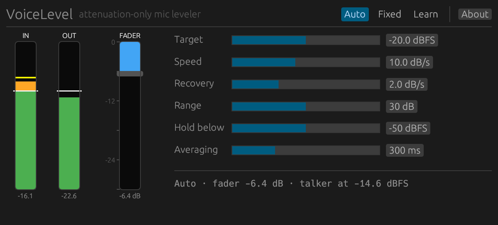

# VoiceLevel

> **AI-assisted project.** This codebase was created with [Claude](https://claude.com/claude-code)
> (Anthropic), directed and reviewed by a human author. The leveler is pinned by unit tests
> (it never boosts, sample for sample; it pulls a hot signal to target at the configured
> dB/s; it holds through silence; Learn measures speech with the pauses left out), the VST3
> passes `pluginval` at strictness 10 with a reported latency of 0, and it has been run live
> on synthesised speech through the standalone build. It has **not** yet been used on a real
> microphone at a real event. Check it in your own rig first.

An attenuation-only automatic microphone leveler for live sound. VST3, CLAP and a
standalone app, built on [nih-plug](https://github.com/robbert-vdh/nih-plug).



*Real screenshot of the standalone build, levelling synthesised speech: the talker measures
−14.6 dBFS against a −20 dBFS target, so the fader has come down 6.4 dB. The yellow tick on
the input meter is the talker's level with the pauses left out — what the fader is steered by.*

<!-- downloads:start -->

## Download

**[v0.1.0](https://github.com/stoatworks-labs/voicelevel/releases/tag/v0.1.0)** — prebuilt for macOS, Windows and Linux. Pick your platform:

<details>
<summary><b>macOS</b> — Universal (Apple Silicon + Intel)</summary>

| Build | Download | Size |
| --- | --- | --- |
| Universal (Apple Silicon + Intel) · .dmg disk image | [`voicelevel-0.1.0-macos-universal.dmg`](https://github.com/stoatworks-labs/voicelevel/releases/download/v0.1.0/voicelevel-0.1.0-macos-universal.dmg) | 14 MB |
| Universal (Apple Silicon + Intel) · .pkg installer | [`voicelevel-0.1.0-macos-universal.pkg`](https://github.com/stoatworks-labs/voicelevel/releases/download/v0.1.0/voicelevel-0.1.0-macos-universal.pkg) | 13 MB |
| Universal (Apple Silicon + Intel) · .zip archive | [`voicelevel-macos-universal.zip`](https://github.com/stoatworks-labs/voicelevel/releases/latest/download/voicelevel-macos-universal.zip) | 13 MB |

</details>

<details>
<summary><b>Windows</b> — x64, ARM64</summary>

| Build | Download | Size |
| --- | --- | --- |
| x64 · .exe installer | [`voicelevel-0.1.0-windows-x86_64-setup.exe`](https://github.com/stoatworks-labs/voicelevel/releases/download/v0.1.0/voicelevel-0.1.0-windows-x86_64-setup.exe) | 2.5 MB |
| ARM64 · .exe installer | [`voicelevel-0.1.0-windows-aarch64-setup.exe`](https://github.com/stoatworks-labs/voicelevel/releases/download/v0.1.0/voicelevel-0.1.0-windows-aarch64-setup.exe) | 2.2 MB |
| x64 · .zip archive | [`voicelevel-windows-x86_64.zip`](https://github.com/stoatworks-labs/voicelevel/releases/latest/download/voicelevel-windows-x86_64.zip) | 6.2 MB |
| ARM64 · .zip archive | [`voicelevel-windows-aarch64.zip`](https://github.com/stoatworks-labs/voicelevel/releases/latest/download/voicelevel-windows-aarch64.zip) | 6.0 MB |

</details>

<details>
<summary><b>Linux</b> — x64, ARM64</summary>

| Build | Download | Size |
| --- | --- | --- |
| x64 · .deb package (Debian/Ubuntu) | [`voicelevel_0.1.0_amd64.deb`](https://github.com/stoatworks-labs/voicelevel/releases/download/v0.1.0/voicelevel_0.1.0_amd64.deb) | 4.9 MB |
| ARM64 · .deb package (Debian/Ubuntu) | [`voicelevel_0.1.0_arm64.deb`](https://github.com/stoatworks-labs/voicelevel/releases/download/v0.1.0/voicelevel_0.1.0_arm64.deb) | 4.6 MB |
| x64 · .rpm package (Fedora/RHEL) | [`voicelevel-0.1.0-1.x86_64.rpm`](https://github.com/stoatworks-labs/voicelevel/releases/download/v0.1.0/voicelevel-0.1.0-1.x86_64.rpm) | 5.0 MB |
| ARM64 · .rpm package (Fedora/RHEL) | [`voicelevel-0.1.0-1.aarch64.rpm`](https://github.com/stoatworks-labs/voicelevel/releases/download/v0.1.0/voicelevel-0.1.0-1.aarch64.rpm) | 4.7 MB |
| x64 · .zip archive | [`voicelevel-linux-x86_64.zip`](https://github.com/stoatworks-labs/voicelevel/releases/latest/download/voicelevel-linux-x86_64.zip) | 7.4 MB |
| ARM64 · .zip archive | [`voicelevel-linux-aarch64.zip`](https://github.com/stoatworks-labs/voicelevel/releases/latest/download/voicelevel-linux-aarch64.zip) | 6.9 MB |

</details>

All builds, checksums and release notes: [github.com/stoatworks-labs/voicelevel/releases](https://github.com/stoatworks-labs/voicelevel/releases).

The Windows builds are unsigned, so SmartScreen warns once — see [Windows SmartScreen](#windows-smartscreen) for the one-time click-through.

<!-- downloads:end -->

Think of it as a virtual fader with an operator's hand on it:

- **It only ever turns the mic down.** Unity gain is the ceiling; nothing in the signal path can
  add gain, so it cannot push a channel into feedback the way an AGC or an upward leveler can.
- **Zero latency.** There is no look-ahead. The audio path is one multiply per sample; the level
  detection runs alongside it. What the fader lags on is *how quickly it moves*, which is what the
  Speed control sets — not a delay on the audio.
- **It aims for a target level** and moves at a fader-like speed (dB per second), so a loud talker
  is brought down over a second or two, not clamped syllable by syllable.
- **It holds still through pauses.** When the input drops below the hold threshold the fader
  freezes: a pause is not a reason to bring a hot mic back up.
- **Learn** listens to the talker for five seconds of speech and parks the fader at the
  attenuation that puts them on target, for the rest of the show.

**User guide:** [docs/USER-GUIDE.md](docs/USER-GUIDE.md).

## Controls

| Control | Default | What it does |
| --- | --- | --- |
| Target | −20 dBFS | Output level the fader aims for (RMS, speech only — pauses are not averaged in). |
| Speed | 10 dB/s | How fast the fader is pulled down when the mic is over target. |
| Recovery | 2 dB/s | How fast it eases back up towards 0 dB when the talker is under target. Deliberately slower than Speed. |
| Range | 30 dB | The most the fader will ever take off. |
| Hold below | −50 dBFS | Below this input level the fader does not move at all. Set it just above the room/handling noise. |
| Averaging | 300 ms | How much speech the level is judged over. Longer is steadier; shorter follows a talker more closely. |
| Mode | Auto | `Auto` — the fader follows the talker. `Fixed` — the fader stays put (drag it in the editor). `Learn` — measure, then commit to `Fixed`. |

The fader position itself is saved with the session but is not a host parameter: the audio thread
moves it in Auto mode, Learn writes it, and you drag it in Fixed mode.

### Learn

Press **Learn** while the talker is speaking. The plugin measures their level (pauses excluded)
for five seconds of speech — or until you press it again, or 30 s of wall-clock time — then sets
the fader to `talker level − target` (clamped to `Range`) and switches to **Fixed**. Switching
from Learn to **Auto** instead commits the same measurement and carries on tracking from there.

In a host without the editor, Learn is the third value of the `Mode` parameter: set it to
`Learn`, let the talker speak, then set it to `Fixed`.

## How it works

Two detectors run on a 100 Hz high-passed copy of the input (so plosives, handling noise and
stage rumble do not pull the fader down):

- a **fast RMS** (10 ms) that answers "is anyone talking right now?" — it drives the hold gate
  and the meters;
- a **slow RMS** (`Averaging`) that only integrates while the gate is open, so it measures the
  level *of the speech* rather than the average of speech and silence. The fader is steered by
  this one: `wanted attenuation = max(0, speech level − target)`.

The fader then slews towards that at `Speed` (down) or `Recovery` (up) and is applied as a
single gain to every channel. On stereo tracks the louder channel steers and both get the same
gain.

## Building

Rust stable. nih-plug is a git dependency, so the first build fetches it.

```bash
cargo xtask bundle voicelevel --release
```

produces `target/bundled/VoiceLevel.vst3`, `VoiceLevel.clap` and (macOS) the standalone
`VoiceLevel.app`. Copy the VST3 to `~/Library/Audio/Plug-Ins/VST3/` and the CLAP to
`~/Library/Audio/Plug-Ins/CLAP/`. `cargo xtask bundle-universal voicelevel --release` builds a
fat macOS binary if both Apple targets are installed.

The standalone runs the plugin on a live device, which is the quickest way to try it on a real
mic:

```bash
./target/bundled/VoiceLevel.app/Contents/MacOS/VoiceLevel --backend core-audio -l 1 \
  --input-device "MacBook Pro Microphone" --output-device "MacBook Pro Speakers"
```

(`-l 1` is the mono layout, `-l 2` stereo; `--help` lists the rest.)

## Tests

```bash
cargo test
```

The leveler core in `src/dsp.rs` is host-agnostic and covered by unit tests: never boosts
(sample-for-sample), pulls a hot signal to target, moves at the configured dB/s, recovers more
slowly and stops at unity, holds through silence, respects Range in every mode, Learn measures
speech with pauses excluded and commits on leaving Learn, stereo linking, rumble rejection, and
a zero-latency impulse.

The bundles have been checked with `pluginval --strictness-level 10` (VST3: passes, reported
latency 0) and `clap-validator` (CLAP: 30 of 34 tests pass; the four failures —
`state-invalid-random` and the three `state-reproducibility-*` rescan checks — are in nih-plug's
CLAP state-load wrapper and reproduce identically on nih-plug's own `gain` example).

## Windows SmartScreen

The released plugins are **Developer ID-signed and notarised** on macOS, so your host loads
them with no quarantine step and no failed validation. The Windows binaries are **not**
code-signed.

- **macOS** — nothing to do. Install and rescan.
- **Windows** — plugin files aren't gated the way `.exe` files are, so your host loads them
  normally. The **installer** trips SmartScreen: **More info** → **Run anyway**.
- **Linux** — no signing gate.

Per-artifact steps and checksum verification: **[docs/UNSIGNED.md](docs/UNSIGNED.md)**.

## Status

First release. The leveler core is covered by 15 unit tests; the VST3 passes `pluginval` at
strictness 10 (editor open while processing, state restore, automation, parameter fuzzing,
reported latency 0); the standalone has been run live on synthesised speech through a
loopback device, where the meters, the pull-down and the hold through silence were all
watched happening.

- [ ] Not yet used on a real microphone in a live signal chain.
- [ ] Met few hosts: validated by pluginval and the standalone only.
- The CLAP build passes `clap-validator` except four state-load checks that fail identically
  on nih-plug's own example plugin — an upstream framework issue, not this plugin's.

<!-- attributions:start -->
This project is built on other people's work — see [ATTRIBUTIONS.md](ATTRIBUTIONS.md).

**Licensing:** this repo is GPL-3.0-or-later throughout — nih-plug's VST3 bindings are GPLv3, so the released binaries are GPL works and the source is licensed to match — see [ATTRIBUTIONS.md](ATTRIBUTIONS.md) before redistributing them.
<!-- attributions:end -->

## Licence

GPL-3.0-or-later. nih-plug itself is ISC, but its VST3 bindings are GPLv3, so a VST3 build has
to be too. See [LICENSE](LICENSE).
